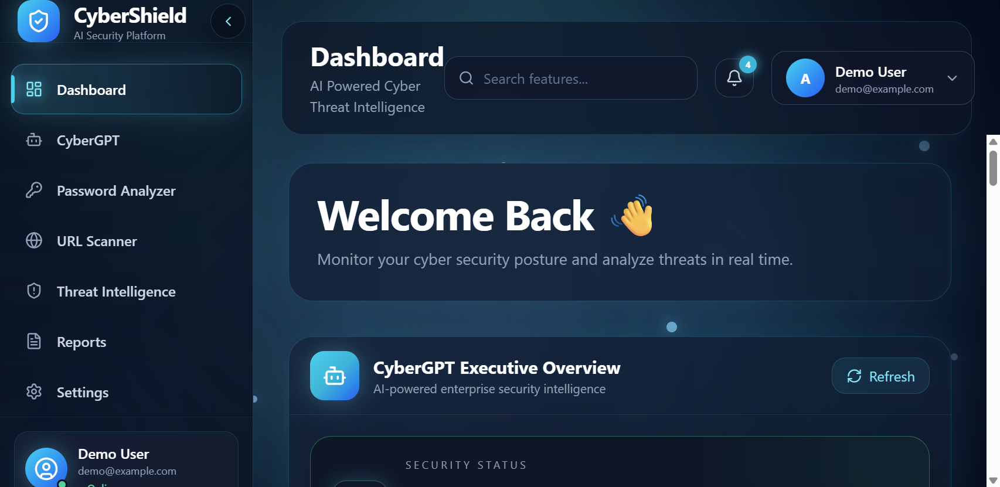
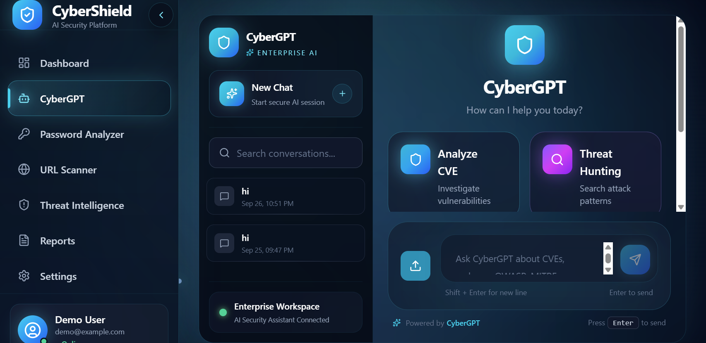
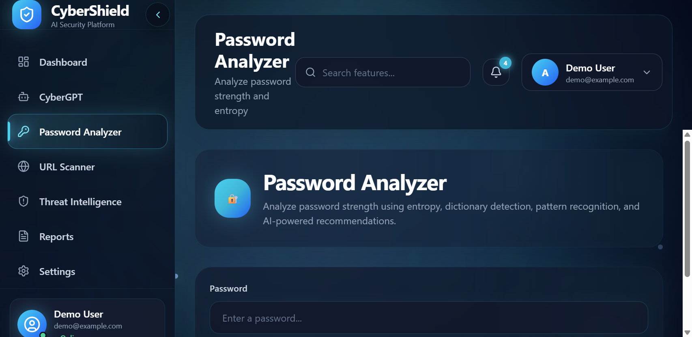
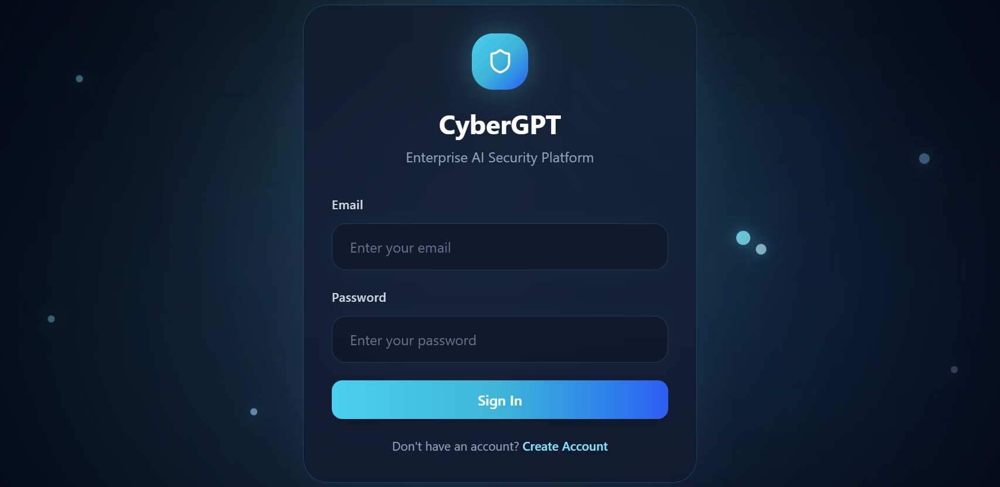
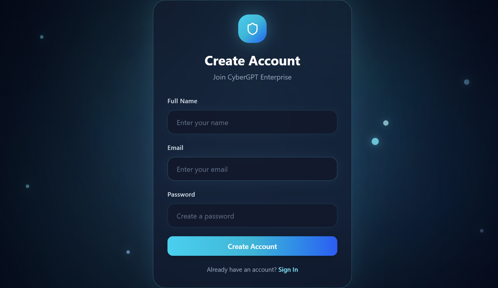
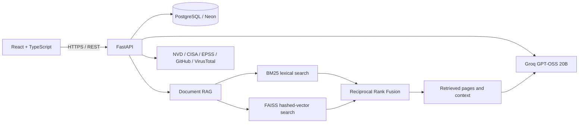

# CyberShield AI

**An AI-assisted cybersecurity workspace for security-document Q&A, vulnerability research, URL triage, and password analysis.**

[Live application](https://cybershieldai-security.vercel.app/login) | [API health](https://cybershield-backend-oz7p.onrender.com/health) | [API docs](https://cybershield-backend-oz7p.onrender.com/docs) | [Deployment guide](docs/DEPLOYMENT.md) | [RAG evaluation](backend/evaluation/README.md)

CyberShield AI brings common security research workflows into one web application. Users can ask questions against security references, inspect CVE intelligence, assess suspicious URLs, and analyze password strength. It is a portfolio project and decision-support tool, not a replacement for security review or incident-response procedures.

## Screenshots

| Dashboard | CyberGPT | Password Analyzer |
| --- | --- | --- |
|  |  |  |

| Sign in | Create account |
| --- | --- |
|  |  |

## What It Does

- **CyberGPT:** Answers cybersecurity questions using retrieved document passages, keeps conversation history, and returns source references.
- **Document intelligence:** Accepts PDF, DOCX, and TXT documents; supports question answering, summaries, and comparisons.
- **CVE Investigation:** An authenticated seven-node LangGraph workflow at `/investigate`, with streaming progress, citation-bound NVD/CISA details, explicit source failures and uncertainty, cancellation, and JSON export.
- **Threat intelligence:** Enriches CVE lookups with data from NVD, CISA KEV, EPSS, and GitHub advisories, then generates summaries and recommendations.
- **URL scanner:** Combines local URL-risk heuristics with VirusTotal reputation results when configured.
- **Password analyzer:** Scores passwords using length, entropy, dictionary-word, and pattern checks; generates recommendations.
- **Dashboard and reports:** Presents account activity and security scan results.

### CVE investigation mode

The sidebar places **CVE Investigation** after CyberGPT; the existing threat APIs
and `/threat-intel` route remain available. Missing source fields show **Not available**.
NVD product criteria are not confirmation of installed-asset exposure. CISA actions
are attributed quotations, not generated remediation.

The server controls activation through `CVE_INVESTIGATION_ENABLED=true`.
`CVE_INVESTIGATION_LIVE_APPROVED=false` keeps clearly labeled synthetic fixtures;
setting it to `true` enables only fixed-origin, read-only NVD and CISA KEV requests.
Both flags default to false. Live activation requires operator approval after validation.
Keep `CYBERGPT_V2_ENABLED=false` unless separately approved; existing chat is unchanged.
No model API key or LLM calls are used by the investigation graph.

Live responses are bounded, checked for matching CVE/catalog identity, cached in
memory (NVD 60 seconds, KEV five minutes), and retain their original retrieval time.
Unauthenticated NVD requests are spaced at least 6.1 seconds per process; 429/5xx
responses apply a bounded cooldown. Multiple backend workers/replicas require a shared
rate gate before scaling. Redirects and inherited proxy credentials are disabled.
Cached results are source snapshots, not a guarantee of current completeness or truth.

## Architecture



The frontend is a React, TypeScript, and Vite single-page application. FastAPI exposes REST endpoints and uses SQLAlchemy with PostgreSQL for application data. The hosted deployment uses Vercel for the frontend, Render for the backend, and Neon for PostgreSQL.

### AI and Retrieval

The configured generation model is **`openai/gpt-oss-20b` through Groq's OpenAI-compatible API**, verified in controlled live validation. Groq hosts generation. Optional local semantic embedding weights are a separate concern; the Dockerfile retains its existing MiniLM warm-up.

For document retrieval, the application extracts text, chunks it at a configurable 600 characters with 100-character overlap by default, and preserves source/page metadata. It combines:

- BM25 keyword retrieval with domain-aware acronym/phrase expansion (e.g., ZTA, PDP/PEP, MFA, RBAC).
- A deterministic, normalized 384-dimensional feature-hashing representation searched with FAISS L2 (or optional dense semantic embeddings).
- Reciprocal Rank Fusion, query-term coverage adjustment, MMR diversity re-ranking, and context-aware follow-up augmentation.

The repository bundles 11 PDFs. CyberGPT v2 admits ten hash-pinned primary references (nine NIST publications and OWASP ASVS 5.0), listed in `backend/knowledge_sources.json`. The file named `owasp-top-10.pdf` is an HHS briefing and is excluded from v2 to avoid false OWASP attribution. The older six-reference evaluation snapshot contained 3,662 chunks; current Render startup logs show an 8,406-chunk shared index using **hash embeddings**. This release does not change the embedding configuration.

### CyberGPT 2.0 activation

`CYBERGPT_V2_ENABLED` remains false until release approval. When enabled, tools
remain deterministic-first; greetings do not invoke retrieval or Groq. Knowledge
questions use the existing hybrid index. Retrieved passages must match the bytes
of an approved bundled PDF or the authenticated caller's own upload. Complete
PDF text blocks/paragraphs become request-local canonical evidence; no new stored
index or vector database is introduced.

Groq selects evidence IDs, and the server copies their complete text before the
existing exact-quotation verifier checks identity, ownership and attribution.
Model prose is never silently corrected into a verified claim. Source cards show
original links and physical page numbers. Quotation attribution does not verify
factual truth, currency or answer completeness. Missing evidence stays explicit.

Ask **"From general knowledge ..."** for a separately labelled, uncited model
answer. Follow-ups use fixed topic labels from the caller's redacted user turns;
raw conversation transcripts and generated passwords do not enter model prompts.
Password generation/analysis, URL tools and CVE routing retain their existing paths.
The chat UI preserves Markdown, safe links, cancellation, retry and history.

After an approved release, `/ready?details=true` reports the enabled flag, provider,
model, approved-source availability and shared-index availability without secrets.
Default `/ready` behavior is unchanged. Live CVE flags remain enabled as configured;
only `CYBERGPT_V2_ENABLED=true` is needed for this activation, with no catalog path
or migration required. Explicit operator catalog manifests remain supported.

## Evaluation

The historical 29-question, manually page-labeled benchmark compares the retrieval methods over the public references. Metrics are macro averages; a hit means the exact labeled source page was returned in the top five.

| Method | Recall@5 | MRR | nDCG@5 |
| --- | ---: | ---: | ---: |
| BM25 (expanded) | 79.31% | 0.5155 | 0.5842 |
| Feature-hashed vectors | 27.59% | 0.1707 | 0.1958 |
| Hybrid BM25 + FAISS + RRF | **79.31%** | **0.6287** | **0.6689** |
| Production pipeline | 62.07% | 0.4782 | 0.5142 |

These are **internal retrieval-benchmark results**, not answer accuracy or a general quality guarantee. The URL heuristic was separately checked on 24 synthetic fixtures: accuracy 87.50%, precision 100%, recall 75%, and F1 85.71%. That fixture set is not a real-world phishing dataset, and the measurement excludes VirusTotal. Generated-answer citation correctness and faithfulness still require manual review.

See [the evaluation guide](backend/evaluation/README.md) for the methodology, per-question rankings, datasets, and rerun command. Results are saved in [backend/evaluation/results.json](backend/evaluation/results.json).

### Current focused validation

The existing 48-question synthetic benchmark was rerun with 24 development and
24 held-out questions. The reviewed grounded-answer evaluation produced 19/19
valid citation links on development and 14/14 held-out, with required-evidence
coverage 17/22 and 12/21 respectively. Held-out false abstentions remain **6/15**
answerable questions; this is a retrieval/coverage limitation, not a solved answer
accuracy benchmark. These deterministic offline results do not measure Groq quality.

Controlled live Groq checks separately covered a public zero-trust question, its
follow-up, an unanswerable request and labelled general knowledge. The two grounded
answers returned three exact source-linked quotations; the unanswerable case made
no provider call. Four examples are a smoke test, not a general accuracy claim.
See [architecture and limitations](docs/ARCHITECTURE.md) and the measured
[readiness results](docs/CYBERGPT_PRODUCTION_READINESS.json).

## Technology

| Area | Technologies |
| --- | --- |
| Frontend | React, TypeScript, Vite, Tailwind CSS, Axios, Recharts |
| API and services | Python, FastAPI, Pydantic, SQLAlchemy |
| Persistence | PostgreSQL; Neon in the hosted deployment |
| Retrieval | FAISS, BM25, feature hashing, Reciprocal Rank Fusion |
| Hosted inference | Groq API, openai/gpt-oss-20b |
| Investigation workflow | LangGraph StateGraph with seven bounded CVE nodes |
| Security data | NVD, CISA KEV, EPSS, GitHub advisories, VirusTotal |
| Deployment | Vercel, Render, Neon, Docker, Docker Compose, Nginx |

## Run Locally

Requirements: Git, Docker Desktop, and a Groq API key for AI responses.

```bash
git clone https://github.com/MoAftab-01/CyberShield-AI.git
cd CyberShield-AI
```

Create the backend environment file:

```powershell
Copy-Item backend\.env.example backend\.env
```

On macOS/Linux, use `cp backend/.env.example backend/.env`. Set `GROQ_API_KEY` and replace `JWT_SECRET` in `backend/.env`, then start the services:

```bash
docker compose up --build
```

Open the frontend at `http://localhost` and the API documentation at `http://localhost:8000/docs`. The Compose setup provides PostgreSQL, backend, and Nginx-served frontend. Never commit `.env` files or real credentials.

## Hosted Deployment

- **Frontend:** [Vercel](https://cybershieldai-security.vercel.app/login)
- **Backend:** [Render API](https://cybershield-backend-oz7p.onrender.com/), with [health check](https://cybershield-backend-oz7p.onrender.com/health) and [interactive API docs](https://cybershield-backend-oz7p.onrender.com/docs)
- **Database:** Neon PostgreSQL
- **LLM:** Groq GPT-OSS 20B

The Render free service may sleep when idle, so the first request can be delayed. Its local filesystem is ephemeral: do not rely on it to preserve user uploads or generated indexes across restarts. Use persistent/object storage for durable files. See [docs/DEPLOYMENT.md](docs/DEPLOYMENT.md) for build settings and environment-variable setup.

## Current Limitations

- Retrieval evaluation is a small, manually labeled benchmark and should be expanded and independently reviewed before making broad performance claims.
- URL-detection scores come from synthetic fixtures, not a representative phishing corpus.
- Generated-answer citation correctness and factual faithfulness have not yet been measured.
- The Copilot API currently uses a placeholder user ID; per-user isolation for Copilot conversations and uploaded documents needs to be completed before handling sensitive data.
- Free-tier hosting can sleep and does not provide durable local upload storage.

## Repository Guide

| Path | Contents |
| --- | --- |
| `frontend/` | React application and Vercel configuration |
| `backend/app/` | FastAPI routes, services, agents, integrations, and retrieval code |
| `backend/knowledge_base/` | Bundled security-reference PDFs |
| `backend/evaluation/` | Curated benchmark cases, result report, and annotation template |
| `docs/` | Deployment and architecture documentation |

Licensed under the terms in [LICENSE](LICENSE).


## CVE Investigation Agent (feature branch)

The authenticated `/investigate` interface runs a bounded LangGraph workflow with NVD/KEV evidence, exact-quotation citations, progress and JSON reports. It is disabled by default; offline synthetic demonstration and separately approved read-only live modes are distinct. See [launch validation and isolated staging instructions](docs/LAUNCH_SPRINT.md).
