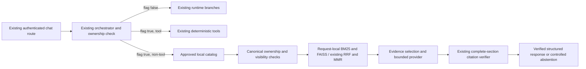

# CyberGPT 2.0 — Phase 2C Batch 1

Date: 2026-11-04. Worktree: E:/placement_personal/Projects/CyberShield-AI-cybergpt-2-source-foundation. Branch: feature/cybergpt-2-source-foundation. HEAD remains 2c6bf6879aee47cb6e432c88a1dab8c57fe1de73.

## Result and boundaries

A working authenticated backend quotation path is available behind CYBERGPT_V2_ENABLED, which defaults to false. Final validation: 57 new integration tests, 378 selected regressions, and the complete 615-test backend suite all pass. The selected groups overlap the full suite. There are zero failures/errors/skips, zero outbound connection attempts and zero PostgreSQL attempts in the final guarded runs.

Nothing enabled the flag in Docker, any dotenv file, or the existing application. No original repository files, containers, databases, uploads, indexes, model caches, infrastructure or dependencies were changed. No migrations, commits, pushes, merges, deployments, model downloads or LangGraph work occurred. The original application's ownership migration remains unapplied according to the task baseline; no live database was contacted to inspect it.

## Architecture

Existing /copilot/ask (normally /api/copilot/ask behind the frontend proxy) still uses its existing JWT dependency and per-account rate limiter. The authenticated database user, never request-provided user IDs, reaches the existing orchestrator. Conversation ownership is checked before persistence, corpus access or provider dispatch.

With the flag false, orchestration, classification, tools and RAG keep their previous branches. The only response addition is optional grounding (null on legacy/tool replies); existing fields and endpoints remain. The frontend/Dockerfile is byte-identical and retains VITE_API_URL=/api.

With the flag true, password/CVE/scan tools keep their deterministic dispatch. Credential-bearing requests stay local or are withheld from retrieval. Non-tool requests use the new adapter; no legacy unverified model fallback or model classification is allowed. Greetings without supporting evidence may abstain in enabled mode. This is intentionally narrower than legacy conversation mode.



New runtime_catalog loads an explicitly configured, server-owned manifest through the existing Catalog ingestion and source registry. It never defaults to evaluation fixtures or promotes existing uploads/index metadata into authority. Public admission still requires approved hashes and registered adapters; private text admission requires an explicit operator-provided owner. Ownerless records receive no guessed ownership.

Canonical catalog authorization and HybridRetriever visibility checks run before embedding/indexing. A request-local RetrievalContext uses existing hash_vectors, BM25 tokenization/Okapi and FAISS IndexFlatL2, then calls the existing hybrid ranking code through a new optional context argument. Default disk-store calls and ranking constants remain unchanged. No monkeypatching of global indexes, shared tenant corpus cache, index writes or model resolution happens on the new path. Private/unrecognized/stale metadata is rechecked after ranking and before and after generation. Tests also cover revocation during a provider call.

The new path explicitly uses hash embeddings to avoid implicit model/cache access. This does not select hash for legacy production retrieval. No claim is made that the new hash path matches live semantic retrieval quality.

## Flag and approved corpus configuration

- CYBERGPT_V2_ENABLED: missing means false. Only booleans or trimmed, case-insensitive true/false strings are accepted; on/yes/0/1 and other values fail validation.
- CYBERGPT_V2_CATALOG_MANIFEST: optional absolute local path, unset by default. Relative/empty paths are rejected. It is server configuration, not a request field.
- Process environment precedence over dotenv settings is preserved. No example/real environment or Docker configuration was edited.
- A missing corpus returns retrieval_failure/corpus_not_configured. A valid empty corpus returns insufficient_evidence. There is no implicit fixture or old-index fallback.

Isolated tests opt in using monkeypatch on the process settings and a temporary synthetic manifest. Test conftest forces the baseline flag false and clears inherited corpus paths before app imports. Requests, query parameters, headers, forged user_id/owner_id fields and messages cannot enable a disabled server flag.

Manifest format reuses artifacts entries: artifact_id, filename, source_id, adapter, trust, sha256 and retrieved_at. filenames must be relative to the manifest directory and resolve within it, including symlink resolution. retrieved_at requires an explicit timezone. Public entries use existing nvd or reference-fixture ingestion rules. Private entries use adapter=private-text, source_id=private-upload, trust=private_upload, plus record_id, title and a positive integer owner_id. All such fields are privileged operator data; no endpoint accepts them. Hashes must match artifact bytes. Dates/versions/source IDs survive ingestion and citation serialization.

Operator review and file permissions remain essential. This batch does not provide a source-curation UI, fetcher, upload-to-catalog synchronization, or authenticated endpoint for admitting documents.

## Evidence, privacy and execution policy

Only complete canonical section quotations can pass. The accepted SelectionPolicy(0.25), strict claim/citation contracts, owner/version/hash resolution, qualifier/negation checks and narrow conflict detection are reused. Source authority is provenance, not proof of truth. Verification scope stays quotation_attribution_only; answer_completeness stays not_verified. No unrestricted paraphrasing or source-driven tool execution is introduced.

Known credential formats and instruction-like source content, including titles, are withheld before encoding and model input. Citation IDs are canonical structural hashes and are not treated as source-supplied passwords. Actual source fields retain credential checks. Bearer/basic authorization values, API-key/access-token assignments, JWT-shaped values and private-key markers receive an additional deterministic boundary. Unicode-normalized detection is included. The adapter has no history argument: raw legacy messages and generated passwords cannot enter its retrieval query or prompt through history. Existing local password analysis/generation and history privacy tests remain intact.

Immediate replies retain structured E-prefixed citation IDs. Persisted display text uses matching numbered [source 1] labels through the unchanged privacy scrubber, so opaque citation hashes are not mistaken for passwords and no general redaction exemption is added. Quotations, source titles, URLs when present, versions and dates remain readable in history. Structured grounding itself is immediate response metadata; durable structured citation storage is deferred. Legacy Source.page remains one-based.

Execution bounds:

| Boundary | Limit |
| --- | --- |
| User question | 4,000 characters |
| Manifest / artifacts | 64,000 manifest bytes; 16 artifacts; 512,000 bytes per artifact |
| Authorized corpus | 256 chunks; 128,000 text characters |
| Retrieval | top 5; 5-second response deadline |
| Provider | one explicit attempt; SDK retries disabled; 6-second request timeout; 900 output tokens |
| Generation/verification | 10-second response deadline; 24,000-character prompt |
| Existing verifier contract | at most 5 claims; 20,000-character raw draft |
| Concurrent background operations | 2 per process; no unbounded submission queue |

Both providers expose a separate chat_bounded path. Legacy OpenAI chat is AST-identical to the pre-batch method; its existing keyword-argument limitation is intentionally not repaired here. Groq legacy retries/client defaults remain unchanged. Only the flagged adapter requests the strict single-attempt path. Provider exceptions, timeouts, malformed JSON, unsupported claims and unknown citations produce controlled abstention, without echoing draft text, exception bodies, catalog paths, foreign counts or raw query diagnostics.

Python cannot forcibly stop an already running thread. A timed-out job retains its capacity slot until it actually finishes, and late exceptions are consumed. No worker persists messages. SDK timeout/retry settings and the fixed capacity bound prevent accumulating unbounded abandoned jobs; a provider that ignores cancellation can temporarily consume the two slots. These are per-process, not distributed, limits.

## Synthetic HTTP example

The test client supplies a signed token for a temporary synthetic account; authentication headers/tokens are deliberately not captured. Server settings are explicitly enabled by the isolated fixture. The example below omits irrelevant override-probe query parameters used by the tests. The complete actual response is in CYBERGPT_2C_BATCH1_RESULTS.json under synthetic_http_example.

Request body (authenticated temporary account):

```json
{
  "question": "What approvals does Juniper TLS recovery require?",
  "conversation_id": null
}
```

Abbreviated response:

```json
{
  "answer": "The retrieved sources state the following. Answer completeness is not verified.\n\n> Juniper TLS recovery requires two independent operator approvals. [E-4f3bf76f73724b37ae4e]\n\n[E-4f3bf76f73724b37ae4e] Juniper recovery (no external URL); section: Recovery; version: v-c6557623e91622c277f916a4860802942c40bdfc6aade10d8e398e8945809cc7; retrieved: 2026-10-01T00:00:00+00:00; trust: synthetic_fixture",
  "sources": [
    {
      "filename": "doc-74c9628d4af6fb7ee141bcc1d453e57fcd28188bb9ee28b49b05a2b3abb7b484",
      "page": 1,
      "folder": "fixture-reference"
    }
  ],
  "conversation_id": 1,
  "retrieval_metrics": {
    "status": "ok",
    "retrieved_count": 1,
    "candidate_count": null,
    "vector_candidates": null,
    "lexical_candidates": null,
    "fusion": "reciprocal_rank_fusion+rerank+mmr",
    "top_score": null,
    "top_term_coverage": null,
    "relevance_floor": null,
    "reason": null,
    "embedding_backend": "hash",
    "top_semantic_similarity": null,
    "scope": null,
    "excluded_by_scope": null
  },
  "answer_basis": "document",
  "grounding": {
    "status": "supported_quotes",
    "abstained": false,
    "verification_scope": "quotation_attribution_only",
    "answer_completeness": "not_verified",
    "claims": [
      {
        "claim_id": "claim-1",
        "text": "Juniper TLS recovery requires two independent operator approvals.",
        "citation_ids": [
          "E-4f3bf76f73724b37ae4e"
        ],
        "verification": "exact_excerpt",
        "kind": "complete_section_quote",
        "section_hash": "2352bc5c2c41df6f18bff02e3285045a07765b668380dceebeb0cc19f703211c",
        "verification_scope": "quotation_attribution_only"
      }
    ]
  }
}
```

Existing response fields remain, including answer, sources, conversation_id, retrieval_metrics, answer_basis, relevance, related_sources, suggestions, intent and routing. The optional grounding object carries verified claims, evidence/provenance, status, reason, abstention and verification scope. Sources are emitted only for verified claims; retrieval_metrics.retrieved_count reports authorized retrieved candidates, independently of citation count.

## Validation

System CPython 3.10.0 with existing installed dependencies; no original virtualenv or models accessed. The external runner blocks outbound DNS/sockets and psycopg2, restricts SQLite to temporary paths, disables pytest plugin autoload/cache and uses isolated upload/vector directories. Its legacy-provider fixture behavior is the same as the accepted Batch 2B runner: only the three legacy unit-test files receive their existing stub automatically, except explicit outage fixtures. New HTTP tests use their own stub providers and real synthetic JWT authentication.

| Final executed group | Pass | Failure/error/skip | Pytest / JUnit seconds | Warnings |
| --- | ---: | --- | --- | ---: |
| New recorded HTTP/config/provider integration | 57 | 0/0/0 | 11.35 / 11.632 | 2 |
| Privacy, citation, retrieval, source and isolation regressions | 378 | 0/0/0 | 20.98 / 21.222 | 2 |
| Complete backend suite | 615 | 0/0/0 | 54.79 / 55.024 | 11 |

The full suite retains the two repaired password-routing tests and Python hashing regression. One old architectural test was deliberately replaced: test_no_live_routes_import_new_answer_boundary prohibited the integration now explicitly requested. Its replacement enforces an adapter/schema verifier-import allowlist, bans evaluation/dataset imports in serving code and checks the false flag default. Functional HTTP tests prove flag-off dispatch and override resistance. No tests were skipped/xfail-marked or old privacy/auth/ownership assertions weakened.

The recording harness observed 5 supported synthetic HTTP responses and 6/6 exact, resolvable claim-to-citation links, including a two-section answer. Fabricated IDs, wrong source/text and non-JSON drafts are rejected. Tests also cover missing/empty corpora, conflicts, unauthorized requests, cross-user conversation/document access, unknown/legacy/forged visibility metadata, source and title injection, historical password isolation, local analysis, credential-bearing scan requests, provider failures, both deadline paths, bounded capacity, tampered/escaping bundles, no global model/index calls, one-based pages and the unchanged real 20/minute account limiter.

These are fixture checks, not a semantic-accuracy or live-provider benchmark. The existing 48-question retrieval evaluation reproduces all seven accepted hash-mode ranking/evidence/abstention metrics exactly. The reviewed answer evaluator also reproduces the accepted results:

| Split | Required evidence coverage | False abstentions | Valid quote citations |
| --- | --- | --- | --- |
| Development | 18/22 | 0/16 | 20/20 |
| Held-out | 16/21 | 2/15 | 19/19 |

The original 16-question benchmark ran as well. No data, labels, retrieval defaults, weights or selection policies were tuned in this batch. Three returned quotes remain unjudged for question relevance across the reviewed splits; semantic entailment accuracy remains null. The experimental source-only evaluator is not the same thing as a real provider integration quality measurement.

Captured synthetic successful HTTP requests took about 13–318 ms including JWT/database/TestClient overhead and stub generation; these five observations are not production latency estimates. Existing retrieval evaluation took 2.062 s wall / 1.922 s CPU, peak RSS 83,984,384 bytes and 164,175 temporary index bytes; answer evaluation took 0.965 s wall / 0.797 s CPU. Model downloads/provider network calls: zero.

Initial diagnostics exposed and fixed a structural citation-ID/password false positive, partial Authorization/Bearer redaction, test limiter collisions from SQLite ID reuse, and history citation display collisions. Final review also corrected one-based pages and prevented shared OpenAI behavior changes by separating bounded calls. Initial failures were not suppressed; all final groups above are clean. Existing deprecation warnings remain.

## Exact changes and reproducibility

Nine existing files modified relative to the 365-file pre-batch SHA256 inventory:

- backend/app/core/config.py — strict false-default flag and absolute manifest option.
- backend/app/agents/orchestrator.py — conditional dispatch, no enabled-mode model classifier, credential boundary and foreground persistence.
- backend/app/rag/retriever.py — optional request-local context; default store branch and ranking math unchanged.
- backend/app/schemas/copilot_schema.py — optional VerifiedAnswer grounding metadata.
- backend/app/services/llm/base.py — explicit bounded-provider method.
- backend/app/services/llm/groq_provider.py — optional one-attempt/zero-SDK-retry path; legacy defaults retained.
- backend/app/services/llm/openai_provider.py — separate bounded method; original chat unchanged.
- backend/tests/conftest.py — explicit test flag/catalog isolation.
- backend/tests/test_grounded_evaluation.py — approved integration/import guard replacing the obsolete blanket ban.

Six new files:

- backend/app/knowledge/runtime_catalog.py
- backend/app/rag/retrieval_context.py
- backend/app/services/grounded_chat_service.py
- backend/tests/test_grounded_chat_integration.py
- docs/CYBERGPT_2C_BATCH1.md
- docs/CYBERGPT_2C_BATCH1_RESULTS.json

All other pre-batch files remain byte-identical, including the registry, ingestion, verifier, source fixtures, evaluation labels, embeddings/stores, password-privacy helper, threat ownership migration/routes/CRUD, fail-closed visibility rules, frontend and Docker files. The machine-readable report contains source hashes, file-level diff statistics, exact results and the synthetic example. Git diff against HEAD also contains accepted uncommitted earlier batches; the inventory defines this batch's delta.

Validation artifacts/runner: C:/Users/moham/AppData/Local/Temp/cybershield-2c-batch1-qy56n7yu. From the isolated worktree with system python:

    python -B <artifact-dir>/isolated_tests.py <worktree> integration-recorded test_grounded_chat_integration.py

    python -B <artifact-dir>/isolated_tests.py <worktree> regressions test_password_privacy.py test_hash_compatibility.py test_router.py test_claim_verifier.py test_grounded_evaluation.py test_answer_selection.py test_retrieval_quality.py test_quality_worker.py test_source_benchmark.py test_source_foundation.py test_configuration.py test_rag_visibility.py test_threat_ownership.py

    python -B <artifact-dir>/isolated_tests.py <worktree> full-offline .

From backend, the existing guarded workers were also executed with PYTHONPATH pointing to that backend:

    python -B -m app.knowledge.evaluation
    python -B -m app.knowledge.quality_evaluation
    python -B -m app.knowledge.answer_improvement_evaluation

## Remaining blockers and Phase 2C Batch 2 recommendation

- Do not activate against the existing local database before the separately approved ownership migration/integration process. It was not applied here.
- Provision and review a privileged catalog manifest and source licensing/provenance, owner mappings and file permissions. Existing uploads and legacy global indexes are deliberately not automatically admitted; source synchronization needs a separate reviewed adapter.
- Validate actual provider JSON compliance, privacy/retention/logging configuration, latency/cost and safe abstention under realistic load in an isolated environment before any live enablement. The suite proves stub-provider wiring, not remote provider reliability.
- Exact quotation attribution does not prove truth, complete answers or general conflict resolution. Credential/instruction recognition is deterministic but heuristic; it is not universal DLP or a complete injection defense. Legacy stored secrets remain untouched.
- Durable structured citation/provenance history and frontend presentation are deferred. Current history retains readable numbered references; only the immediate API response contains the structured grounding contract.
- Source selection is current-snapshot-only here; historical snapshot controls, semantic embedding integration, larger corpora and distributed quotas/caching need separate evaluation and approval.

Recommend Batch 2 focus on an isolated integration environment, reviewed source admission and durable citation presentation/validation, keeping the flag off for the existing app. Retain the current quotation policy until independent relevance/entailment review is available. No LangGraph work is recommended in this step.

Community context: Bobby Hall Jr.'s article Your RAG Filter Runs Too Late. Build a Tenant-Safe Retriever in TypeScript. (https://dev.to/bobbyhalljr/your-rag-filter-runs-too-late-build-a-tenant-safe-retriever-in-typescript-5elk) illustrates why authorization must precede top-k/model input. The article uses a small synthetic fixture and does not prove production isolation; neither do this batch's offline tests. It informed the pre-index authorization boundary, not a dependency or architecture replacement.

Stopped after implementation and validation for review.
