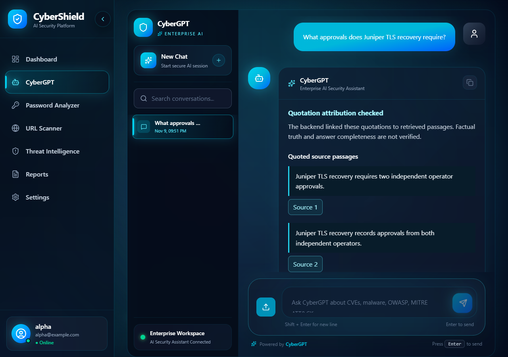
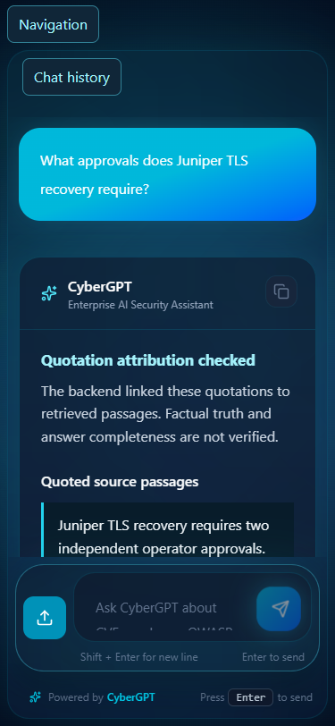

# CyberGPT 2.0 — Phase 2C Batch 2

Validation date: 2026-11-10 (Asia/Calcutta). Worktree: E:/placement_personal/Projects/CyberShield-AI-cybergpt-2-source-foundation. Branch: feature/cybergpt-2-source-foundation. HEAD remains 2c6bf6879aee47cb6e432c88a1dab8c57fe1de73.

## Outcome

The existing React chat now displays optional structured grounding metadata, verified quotation references, provenance disclosures, safe source links, dates and controlled evidence-status messages. It preserves legacy Markdown/source rendering when grounding is absent or null. The frontend does not enable or send the server feature flag.

Final checks passed: frontend lint, TypeScript, production build, 50 frontend unit tests, 17 production-UI browser/API checks, 142 selected backend regressions and all 615 backend tests. Lint retains one unchanged AuthContext Fast Refresh warning. Vite warns about a large main chunk. No test assertions were skipped or weakened to obtain these results.

The user explicitly approved npm ci --ignore-scripts --no-audit --no-fund in a disposable frontend copy. 251 locked packages were installed under the temporary artifact directory only, from registry.npmjs.org. No packages or build outputs were installed into either repository; dependency versions and the source lockfile are unchanged. No models were downloaded.

## Integration

- Active path: AppRouter /copilot -> Copilot.tsx -> askCopilot -> existing authenticated FastAPI route -> MessageList -> ChatMessage. Optional grounding reaches a separate GroundedAnswer component. Unused empty chat/page placeholders were left alone.
- Existing API endpoint, JWT interceptor, AuthContext, response fields and legacy SourceCard behavior remain. The request helper sends only question/conversation_id and accepts an AbortSignal. Production tests build with VITE_API_URL=/api; frontend/Dockerfile and services/api.ts remain byte-identical.
- Supported answers render complete source quotations in blockquotes with numbered citation buttons. The status says Quotation attribution checked and explicitly says factual truth and answer completeness are not verified. No confidence percentages or factual-verification badges are invented.
- Source disclosures show title, section, canonical URL when safe, known organization label, public/private/synthetic classification, publication/modification/retrieval dates in UTC, source version and evidence ID. Organization labels come only from known source IDs; unknown sources say not provided. Source authority is not treated as proof of truth.
- Insufficient evidence, retrieval failure, unsupported claims, unsafe/unverified evidence, provider failure and conflicting sources have separate fixed messages. Arbitrary model/error text is not used as the status explanation.
- A small runtime display validator checks field bounds, contract scope, claim/evidence identity, exact text attribution, duplicate/missing references and inconsistent private provenance. Malformed structured metadata fails closed: neither its raw answer nor unverified source cards are rendered. Entirely absent/null grounding remains a legacy reply for compatibility. This client validator does not replace server authorization or canonical verification.
- Existing saved history remains server-owned display text. It is not retroactively labelled verified or reconstructed into grounding metadata. Backend structured citation persistence remains out of scope; numbered historical references continue to display through the old renderer.

## Privacy, request lifecycle and accessibility

The evidence renderer uses literal React text, never raw HTML or executable instructions. Citation links require an absolute HTTPS URL without embedded credentials, control/whitespace characters or backslashes; javascript/data/vbscript/file/http/mailto/relative URLs are non-clickable. External links use noopener/noreferrer and announce a new tab. Passages themselves never auto-load images, scripts or remote content.

Evidence lives only in current in-memory chat state; no new localStorage/sessionStorage, analytics, browser tracing or evidence cache was introduced. Structured responses do not duplicate the backend's raw formatted answer into message text. Existing auth-token localStorage behavior is preserved. Passwords remain immediate authorized display text; no response/request bodies or raw Axios errors are logged by the changed chat flows. The history rename flow previously logged raw Axios errors; it now reports a fixed accessible error, including when a pasted synthetic password is in the failed request.

Abort controllers prevent double submissions and drop late responses after cancellation, new chat, history selection or unmount. History loads use a view version so stale results cannot replace a different conversation. Failed sends expose an explicit manual retry; no automatic resubmission occurs. The UI warns that a timed-out/cancelled request may already have completed on the server. Cancellation does not delete or roll back server records. New conversation titles are fetched from the server's redacted title rather than storing a raw submitted password as an optimistic title.

Citation buttons use aria-controls/aria-expanded, unique per-message IDs and native details/summary disclosures. Keyboard activation opens and focuses the corresponding source. Focus rings are visible inside clipped disclosures. Conversation title selection is a native button, icon controls have names, rename errors use an alert, request status uses a small polite live region, and mobile history/navigation toggles support Escape. The composer has named input/send controls. Reduced-motion preferences are respected in the scoped chat styles.

Mobile layout hides the desktop navigation/history columns behind accessible toggles and wraps long provenance fields. A stronger control-bounds check found a pre-existing decorative glow producing horizontal scrollable overflow in the composer; clipping that decoration and fixing flex minimum widths keeps upload/send controls visible. The final 375x812 check measured the upload button at x=26 with width=48 and the send control inside the viewport. Source controls were also exercised at 1280x900. This is programmatic/browser accessibility evidence, not a WCAG certification or manual screen-reader audit.

## Browser evidence

Production Vite output was served by fresh localhost-only FastAPI processes with actual AppRouter, AuthContext, protected routes, production Tailwind CSS, Sonner, API services, JWT login and SQLAlchemy sessions. The backend used explicitly isolated SQLite, synthetic alpha/beta accounts, operator-approved fixture catalogs and stub providers. PostgreSQL and outbound socket connections were guarded. No dependency overrides bypassed authentication.

Each browser context received a real synthetic JWT through one-time in-memory storage state, not an on-every-navigation token injector. Invalid authentication therefore genuinely clears storage and reaches the real login route. Two server processes separately exercised true/false startup settings; no browser request changed a server flag. Only the created child processes and temporary Chrome instances were stopped. Existing Docker/services were never started, inspected, restarted or killed.

17 production browser cases cover:

1. Authenticated multiple-citation answer from real hybrid retrieval/verifier.
2. Desktop keyboard citation controls and screenshot.
3. Missing metadata presentation.
4. Conflicting-source presentation.
5. Literal source HTML/instructions and unsafe canonical scheme.
6. Password-safe failed rename diagnostics.
7. Keyboard history loading without invented verification.
8. Provider timeout status.
9. Network failure and manual retry.
10. Cancellation/new-view protection against delayed replies.
11. Immediate generated-password display without storage/logging.
12. Owner access to private evidence.
13. Cross-user retrieval and conversation rejection.
14. Invalid JWT cleanup and login redirect.
15. Unauthenticated frontend protected-route redirect.
16. Mobile source/history/navigation keyboard controls and composer bounds.
17. Legacy rendering against a disabled server.

The missing/conflicting/instruction presentation cases deliberately intercept a test response in the browser; they test defensive display even for responses the real verifier would normally reject. Positive answers, normal abstention, timeout, password generation, history and cross-user checks use the real isolated API. Neither synthetic source text nor stub providers demonstrate live-model semantic correctness.

Additional checks: 15 separate component-browser cases passed, including HTTPS links, organization/date display, duplicate/disparate references, invalid metadata, inert source markup, password storage/logging and mobile keyboard behavior. An earlier page-only harness passed 10 cases with a toast stub and fixture CSS; the final 17-case production run supersedes that limitation. Browser external-request attempts and synthetic-password console disclosures: zero.

Chrome 155.0.8059.80 and existing Playwright 1.62.1 were used without downloading a browser. The screenshots contain only synthetic public fixtures and the synthetic account alpha.

## Exact validation results

| Check | Result | Details |
| --- | --- | --- |
| Frontend lint | Pass | 0 errors; 1 pre-existing only-export-components warning in unchanged AuthContext |
| TypeScript | Pass | tsc -b --pretty false; 0 errors |
| Production build | Pass | Vite 8.1.5; VITE_API_URL=/api; main chunk about 1,585.75 kB / 471.84 kB gzip, CSS 107.24 kB |
| Frontend unit tests | 50 passed | 0 failures/skips; native Node test runner |
| Production browser/API | 17 passed | 0 failures; real production frontend and isolated authenticated backend |
| Component browser | 15 passed | 0 failures; existing local React/esbuild toolchain |
| Backend integration/privacy/citation | 142 passed | 0 failures/errors/skips; 2 warnings; 23.63 s pytest / 24.437 s JUnit |
| Complete backend suite | 615 passed | 0 failures/errors/skips; 11 warnings; 56.02 s pytest / 56.303 s JUnit |

Groups overlap; do not add subset counts to the full suite. Runtime backend modules, retrieval defaults, verifier/evaluation fixtures, migration scripts and authentication policy are byte-identical to the accepted Batch 1 baseline. The backend suite includes existing retrieval evaluation regressions. No retrieval tuning or source/qrel changes occurred.

Toolchain: Node 24.14.0, TypeScript 6.0.3, React/ReactDOM 19.2.8, Vite 8.1.5, oxlint 1.76.0 and system Python 3.10.0. User-approved dependencies were installed only in C:\Users\moham\AppData\Local\Temp\cybershield-2c-batch2-b7eo7kgp/frontend. Native optional build packages worked with lifecycle scripts disabled. The worktree itself still has no node_modules or dist directory.

Initial checks were blocked by missing frontend dependencies until approval arrived. Setup corrections included applying the synthetic catalog after settings import, using schema-valid reserved example.com emails, and initializing test tokens once so redirects could not restore them. New lint findings were resolved without suppressing rules. The mobile overflow and raw rename-error logging were confirmed defects and fixed without weakening their assertions. No unresolved test failures remain.

## Exact files changed

Ten existing frontend files:

- frontend/package.json — adds the dependency-free Node test command; dependency ranges unchanged.
- frontend/src/types/copilot.ts — optional grounding contract and nullable conversation ID.
- frontend/src/services/copilotService.ts — bounded response parsing, request-field whitelist and cancellation signal.
- frontend/src/pages/Copilot.tsx — metadata propagation, request/view lifecycle, safe errors and responsive history toggle.
- frontend/src/components/copilot/MessageList.tsx — forwards optional metadata.
- frontend/src/components/copilot/ChatMessage.tsx — new evidence renderer branch; legacy branch retained; safe copy behavior.
- frontend/src/components/copilot/ChatInput.tsx — named controls and loading guard.
- frontend/src/components/copilot/ChatFooter.tsx — mobile flex sizing and decoration clipping.
- frontend/src/components/copilot/ConversationItem.tsx — keyboard title button, named controls and password-safe rename failure.
- frontend/src/components/layout/CopilotLayout.tsx — accessible scoped mobile navigation.

Fourteen new files:

- frontend/src/lib/grounding.ts
- frontend/src/components/copilot/GroundedAnswer.tsx
- frontend/src/components/copilot/grounding.css
- frontend/tests/fixtures.ts
- frontend/tests/grounding.test.ts
- frontend/tests/e2e/entry.tsx
- frontend/tests/e2e/components.mjs
- frontend/tests/e2e/page.tsx
- frontend/tests/e2e/page.mjs
- frontend/tests/e2e/server.py
- docs/CYBERGPT_2C_BATCH2.md
- docs/CYBERGPT_2C_BATCH2_RESULTS.json
- docs/validation/cybergpt-2c-batch2/desktop.png
- docs/validation/cybergpt-2c-batch2/mobile.png

The report JSON includes before/after source hashes against the 371-file pre-batch inventory, test evidence and installed versions. All 361 out-of-scope baseline files remain byte-identical. The source lockfile and dependency definitions match the baseline, as do frontend/Dockerfile, services/api.ts and AuthContext. Prior uncommitted work was preserved; no files were staged or committed.

## Reproduction and isolation

Artifacts: C:\Users\moham\AppData\Local\Temp\cybershield-2c-batch2-b7eo7kgp. Source test commands assume the isolated worktree frontend as cwd. Use a new external artifact directory for each page-server run, preserving previous test databases rather than resetting them.

    npm test

With an existing local package root providing Playwright/esbuild, set CYBERSHIELD_BROWSER_TOOLS to that root and CYBERSHIELD_UI_ARTIFACTS to a fresh external directory. No command auto-installs packages or browser weights.

    node tests/e2e/components.mjs

For full production tests, first build a disposable copy with the existing lockfile and VITE_API_URL=/api. Set CYBERSHIELD_FRONTEND_DIST to its dist directory, then:

    node tests/e2e/page.mjs

The test server refuses a worktree dotenv file, requires its own backend source path, and confines storage/assets to its supplied temporary test area. It creates synthetic tables in a new test database; it never applies migrations or opens the existing application's database. It mounts the real routers without importing the live main/startup application. Browser login credentials are synthetic fixture values; no tokens, request headers, provider prompts or password screenshots are recorded.

Backend commands used the accepted external isolation runner copied into C:\Users\moham\AppData\Local\Temp\cybershield-2c-batch2-b7eo7kgp:

    python -B <artifact-dir>/isolated_tests.py <worktree> backend-integration test_grounded_chat_integration.py test_password_privacy.py test_claim_verifier.py test_grounded_evaluation.py

    python -B <artifact-dir>/isolated_tests.py <worktree> full-offline .

## Remaining blockers and Batch 3 recommendation

- Keep CYBERGPT_V2_ENABLED=false in the existing application. Its ownership migration remains unapplied according to the project baseline. Applying it to real data requires separate approval and validation.
- Review/provision the privileged source catalog, actual user ownership mapping, source licensing and private-data retention policy. Existing uploads/indexes are not automatically admitted by the prototype.
- Real provider behavior, latency/load, privacy/retention settings and logging controls were not validated with live requests. All model responses in these tests are stubbed.
- Durable structured citation history is deferred. Historical display text remains compatible but cannot expose source disclosures/verification metadata that was never persisted.
- Existing AuthContext lint warning and large build chunk remain; no unrelated refactoring was performed to remove them. Accessibility checks are programmatic plus visual screenshots, not a manual screen-reader audit.
- Frontend metadata validation is defensive presentation, not independent evidence authorization, factual truth checking or a complete prompt-injection/DLP defense. Canonical server verification and tenant checks remain mandatory.

Recommend Phase 2C Batch 3 focus on an approved disposable PostgreSQL integration environment, reviewed source admission and a minimal durable-citation-history design. Validate any schema changes and source/model privacy policy independently before controlled activation. Do not begin LangGraph or enable the existing Docker stack as part of that preparation.

Community context: SupportKit AI's DEV article 5 things I learned building an embeddable AI chat widget that runs on other people's websites (https://dev.to/supportkitai/5-things-i-learned-building-an-embeddable-ai-chat-widget-that-runs-on-other-peoples-websites-55k0) discusses treating generated content as untrusted text. This batch retains literal rendering and independently tests it in the actual UI; the article is design context, not proof of security.

Stopped after implementation and validation. No original working directory, existing containers, real PostgreSQL, indexes, uploads, production settings, model caches, migrations or deployed services were modified. No commit, push, merge or deployment occurred.
