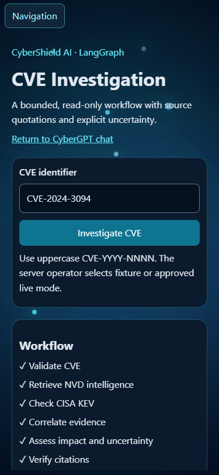
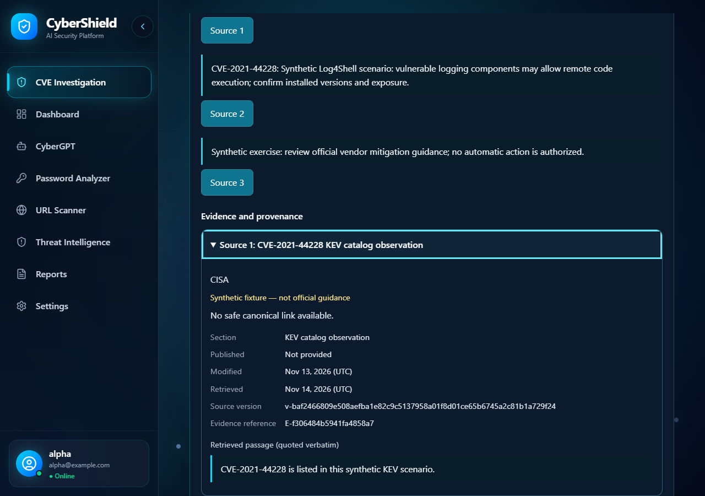

# CyberShield AI: launch sprint

Date: 2026-11-14 (Asia/Calcutta). Feature branch: feature/cybergpt-2-source-foundation.
PR: https://github.com/MoAftab-01/CyberShield-AI/pull/1 (draft, against main).

## Delivered

The previously completed CyberGPT 2.0 source/provenance/evaluation/security/UI work was
inventoried, scanned, tested and published as commit f2feed8. The original application
directory, Docker stack, PostgreSQL/Neon, uploads, indexes and model caches were untouched.

The new CVE Investigation API runs a genuine compiled LangGraph StateGraph:
validate -> nvd -> kev -> correlate -> assess -> verify -> report. Input rejection
routes directly to a controlled report without tools. Transient source failures retry
at most twice per source; unavailable intelligence takes the insufficient/partial path.
The graph has a recursion limit, no checkpointer, no caller-controlled configuration,
no shell/exploitation/remediation tools and no LLM calls.

Correlation reuses the existing request-local hash embeddings, FAISS, BM25, RRF/MMR,
canonical catalog and visibility rules. An exact canonical record-ID fallback retains
sections whose own text omits the CVE. This changes no production retrieval default
and reads/writes no shared corpus/index. Canonical authorization is checked before
encoding and again before citation verification. Foreign private passages fail closed.

NVD uses the existing NvdAdapter; CISA KEV records preserve snapshot dates and versions.
Only exact complete source quotations pass the existing verify_draft contract. Source
authority and valid citation links do not establish factual truth or complete impact.
The assessment node marks asset exposure, deployed versions and business impact unknown
and flags withdrawn-NVD/positive-KEV conflicts; it does not invent an asset risk score.

The protected /investigate React page reuses the existing layout, authentication and
GroundedAnswer renderer. It presents real streamed workflow transitions, source
quotations, provenance, limitations, errors, cancellation and a JSON download.
It uses literal text, existing HTTPS URL validation, keyboard-accessible controls and
responsive layouts. Reports remain in request/browser memory until an explicit user
download; they are not added to conversations or server persistence.

## Modes and API

Server settings (strict true/false, both false by default):

- CVE_INVESTIGATION_ENABLED: enable only the new authenticated endpoint.
- CVE_INVESTIGATION_LIVE_APPROVED: operator approval for fixed read-only NVD/CISA HTTP.
- CYBERGPT_V2_ENABLED remains false by default and independent of investigation.
- VITE_API_URL=/api is preserved.

POST /investigations/cve accepts only {"cve":"CVE-2021-44228"} and authenticates with
the existing JWT dependency. User IDs, URLs and mode overrides in the body are rejected.
The normal response is JSON; ?stream=true returns bounded newline-delimited JSON
progress events followed by the report. Nginx staging configuration disables buffering.

The default enabled mode is explicitly synthetic/offline. Demonstration identifiers:
CVE-2021-44228, CVE-2023-44487, CVE-2024-3094. Fixture prose is original CC0-1.0,
not NVD/CISA guidance. Fixture citations have no invented official source URL.

The live adapter requires explicit operator approval, accepts only registered NVD/CISA
origins, validates the CVE before I/O, uses GET only, refuses redirects/inherited
proxy credentials, bounds responses and timeouts, and emits fixed errors. No live
intelligence HTTP requests were made during this sprint. Live accuracy, rate limits,
slow-response behavior and network latency are not validated by offline fixtures.

The API permits six investigations per authenticated user per minute and two active
investigations per worker. These in-memory limits reset on restart and multiply with
workers. No client-forwarded IP header supplies identity or approval.

## Authentication and compatibility

- JWT verification now requires a nonempty well-formed string subject and finite,
  unexpired numeric expiration. Missing, malformed, expired and invalid bearer
  credentials consistently return 401 with WWW-Authenticate: Bearer.
- NUL inputs and malformed stored password hashes produce controlled authentication
  failure. Registration rejects unsupported NUL characters without echoing values.
- Duplicate-registration races roll back and return the existing controlled duplicate
  response. The race was exercised against real disposable PostgreSQL.
- Login/registration throttling uses the connected peer, not forwarded headers.
  Reverse-proxy peers may share this conservative budget; a real ingress policy is
  required before multi-instance public deployment.
- Bcrypt's existing 72-byte behavior is preserved, including long-password account
  compatibility. No account rehash, password-policy migration or data rewrite occurred.
  This compatibility limitation still needs a separately approved upgrade strategy.
- Database startup errors no longer suggest insecure SQLite runtime fallback or
  print configuration-derived host fragments. /health remains liveness; /ready
  performs read-only database/ownership-column checks and uses fixed 503 diagnostics.

LangGraph was already installed but its declared dependencies conflicted with the old
LangChain pins. Compatible patched declarations were validated in a disposable overlay:
LangGraph 1.2.21, langchain-core 1.7.7, langchain-community 0.4.2,
langchain-text-splitters 1.1.3, pydantic-settings 2.15.0.
Resolved graph dependencies include checkpoint 4.3.1 and SDK 0.4.14.
No checkpoint or SDK server is used by this feature.
The root requirements now delegate to backend/requirements.txt to avoid divergent pins.

The complete declared runtime set resolved successfully (114 packages, dry run).
The temporary overlay installation noted the unrelated globally installed legacy
langchain 0.3.14 conflicts with modern core; that legacy package is not declared by
the updated application. Global/application environments were not modified.
A clean Linux image build remains required; the Windows overlay and resolver check
are not presented as proof of a container build. No models were downloaded.

## Actual validation

| Check | Final result |
| --- | --- |
| Baseline backend before sprint implementation | 615 passed; 11 warnings; 199.14 s |
| Final complete backend suite, repository isolation runner | 669 passed; 0 failures/errors/skips; 13 warnings; 105.55 s |
| Focused security/privacy/ownership regressions | 166 passed; 3 warnings; 19.55 s (subset) |
| New runner selected API/graph/auth/verifier/readiness | 76 passed; 13 warnings; 18.24 s (subset) |
| Frontend unit tests | 58 passed; 0 failures/skips |
| Frontend lint | Pass; one unchanged AuthContext Fast Refresh warning |
| TypeScript / Vite production build | Pass; existing large-chunk warning (~1,593.62 kB main JS) |
| Production UI / isolated real API browser checks | 22 passed; 0 failures; external attempts 0; synthetic-password disclosures 0 |
| Disposable PostgreSQL migration / API / startup | 26 checks passed; cluster stopped |
| New staging Compose configuration | Pass; 3 services / 3 new named volumes; no container launch |
| Runtime dependency resolution | Pass; 114 packages; no application install |
| Source secret scan | No findings; source-location diagnostics only |

Subset counts overlap and must not be added to the full backend count.
The final backend suite includes the existing retrieval/grounded-answer benchmarks,
upload, CVE, authentication and password-routing/privacy regressions. Both previously
failing password-routing assertions remain passing.

The initial full run had 665 passes and two contract failures: the old missing-token
403 expectation and a verifier import allowlist. The first now requires 401 plus the
Bearer challenge; the second explicitly permits the new opt-in agent's exact imports
and verifies disabled feature defaults/lazy heavy imports. Neither test was skipped
or reduced to an accept-any-status assertion. A retry-progress label mismatch,
test-fixture setup, Windows PostgreSQL output-pipe handling, frontend type/test setup,
and new Unicode display encoding were corrected before the final successful runs.

Toolchain: Python 3.10.0, native PostgreSQL 18.3, Node 24.14.0, React 19.2.8,
TypeScript 6.0.3, Vite 8.1.5, Chrome 155.0.8059.80, Playwright 1.62.1.
Frontend dependencies were reused from the previously approved disposable install.
No browser or model weights were downloaded.

## Clean-checkout portability correction

The first GitHub Linux run installed all declared dependencies and passed frontend
validation, but backend tests reported 522 passed, 14 failed and 133 errors because
Git had normalized hash-pinned JSON fixtures from CRLF to LF. Integrity checks
correctly refused those changed bytes. This had been missed by working-tree-only
validation before the initial publication.

A separate corrective commit preserves bytes only in the four evaluation JSON
directories through .gitattributes. Fifteen files differ only in line endings from
the earlier Git blobs; all artifact contents, approved hashes, questions, labels
and integrity assertions remain unchanged. The new check_fixture_bytes.py command
verifies 14 pinned relationships against both the checkout and staged Git blobs.
It runs before CI tests. The next Linux run passed all pin checks and 666 tests,
with three remaining worker failures because the protected-original path matched
GitHub's own clone named CyberShield-AI. A separate correction permits only
checkout-local Python code and reviewed JSON fixture reads in that case. It still
blocks environment/database/upload/index/model-cache reads, every separate-original
read, all writes outside the worker scratch directory and all network access.
Eleven concrete path regressions cover both layouts. The PR checks provide the
clean-Linux rerun evidence.

## Investigation evaluation

Twenty deterministic scenarios cover three real CVE identifiers and a synthetic
unassigned identifier: positive/negative KEV snapshots, missing NVD data, transient
retries, source outages, mismatched CVEs, withdrawn records, stale snapshots,
malformed/duplicate records, identifier-free descriptions, long sections and injection.
Labels live in cases.json; source fixtures do not read labels; runtime adapters import
neither evaluation labels nor scenario fixtures. No held-out tuning occurred.

| Metric | Actual offline result |
| --- | --- |
| Expected investigation outcome | 20/20 |
| Tool-call correctness | 20/20 cases; fixed sources/CVE, bounded attempts |
| Exact quotation citation validity | 39/39 links |
| Expected source-family coverage | 27/27 |
| Median graph execution | 6.0225 ms |
| p95 graph execution | 9.246 ms (lower order-statistic estimate, n=20) |
| Sum of graph execution times | 162.132 ms |
| LLM calls / input tokens / output tokens | 0 / 0 / 0 |
| Estimated model API cost | USD 0; excludes infrastructure and future network costs |

Timing excludes graph compilation/import startup and uses synthetic local adapters.
These are workflow/canonical-quotation regression results, not independent factual,
semantic-entailment, exploitation-risk or production-quality accuracy measurements.
Expected source-family coverage does not mean complete claim or asset-impact coverage.
Long sections that cannot satisfy complete-section quotation verification can yield
partial results. No unrestricted paraphrasing was introduced.

## PostgreSQL migration evidence

backend/validation/disposable_postgres.py creates a new native cluster in a fresh
temporary directory with unique credentials, data-directory/port/PID-file checks and
a database marker before migration/application use. It never accepts DATABASE_URL.
It uses synthetic users and expected legacy schema only; no Docker volume is reused.

Migration 001 preserves legacy ownerless rows with NULL ownership and makes no guessed
assignments. It is intentionally single-use: a second application fails cleanly.
A forced mid-migration FK failure rolls back the added column. Index, FK delete action,
ORM columns/nullability, valid owner writes, FK rejection, A/B history/statistics,
authenticated graph execution, real duplicate-email race, actual application startup
and readiness passed. See the machine-readable PostgreSQL report in validation/.

Only clusters created by this harness were stopped. Temporary synthetic cluster files
are retained for inspection; initialization-password files are removed. Existing
application data and ownership migration state remain unchanged.

## Reproduce without real services

From this feature worktree, with the declared dependencies available:

    python -B backend/validation/secret_scan.py
    python -B backend/validation/run_isolated_tests.py full-offline .
    python -B backend/evaluation/investigation/run.py --output <external-output.json>
    python -B backend/validation/disposable_postgres.py

The test runner establishes temporary SQLite/storage and blocks outbound networking
and all PostgreSQL connections. The PostgreSQL harness is a separate explicit command
that creates and identity-checks its own cluster. Never point either at application
uploads, indexes or the existing database.

Frontend validation in an external disposable source copy with locked dependencies:

    npm test
    npm run lint
    npm run build

Build with VITE_API_URL=/api. To run the full browser demonstration, set
CYBERSHIELD_FRONTEND_DIST to that copy's dist directory, CYBERSHIELD_UI_ARTIFACTS
to a fresh external directory and CYBERSHIELD_BROWSER_TOOLS to an installed package
root providing Playwright/esbuild; then run:

    node frontend/tests/e2e/page.mjs

This starts only temporary localhost FastAPI/Chrome processes with synthetic accounts,
real JWT login and stubbed providers. It executes both chat and investigation flows,
records public-fixture screenshots and stops those processes. It does not start the
existing Docker stack or import its environment.

## Staging preparation and rollback

docker-compose.staging.yml is standalone, with its own project/network/volumes,
no container_name or external volumes, loopback ports 18080/18002 and no PostgreSQL
host port. Dockerfile.staging variants avoid embedding-model warming; staging uses
request-local hash/demo retrieval and keeps CyberGPT v2/live intelligence disabled.
Backend runs as a non-root user. /ready gates service health. Environment variants
are excluded from both build contexts. Nginx preserves /api and streams progress.

Before any staging activation, provision separate credentials in a secret manager:
STAGING_DATABASE_URL (this new postgres service only), STAGING_JWT_SECRET (strong
independent signing key), STAGING_PG_PASSWORD_FILE (external private file matching
the URL credential). No real secrets were generated or provisioned by this sprint.
Do not put these values in Git, logs, screenshots or PR comments.

After review, validate the new file without printing its expanded secret values:

    docker compose -f docker-compose.staging.yml config --quiet

A separately reviewed activation can build/start that standalone file and use
http://127.0.0.1:18080/investigate after creating a synthetic staging account.
Do not use the original Compose files or existing database URL. Do not run a new
migration against the original local application; existing databases require separate
approval for 001, while fresh staging ORM schema creation includes the ownership column.

Rollback first disables CVE_INVESTIGATION_ENABLED, retaining JWT/password/ownership
fixes and all data. To stop only staging, use the explicit staging compose file's
down command without a volume-removal flag. Do not reverse the ownership migration,
delete volumes/indexes, reset Git or roll back to unauthenticated threat routes.

Remaining activation blockers: clean Linux image/build smoke test, separate staging
credentials/ingress/TLS/rate policy, approval and measurement of fixed-origin live
intelligence, provider/semantic-model validation if those independent features are
enabled, and review of legacy bcrypt/private-history retention limitations.
The original deployed/local application is unchanged and is not certified secure by
these isolated tests. Durable structured chat citations and broader source admission
remain separate work; investigation reports intentionally are not persisted.

Recommended next action: review this PR and activate only a fresh isolated staging
environment, then approve a small read-only NVD/CISA smoke test before a public demo.
No merge, production deployment, existing-service activation or real migration occurred.

